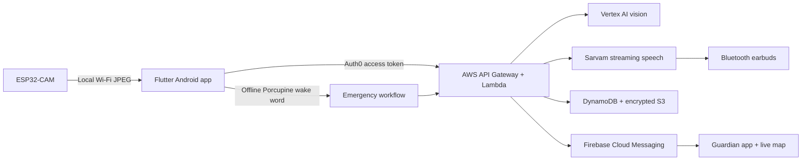

<p align="center">
  
</p>

<h1 align="center">Blind Way</h1>

<p align="center">
  Android-first vision guidance, offline emergency wake-word detection, and live guardian coordination for blind and low-vision users.
</p>

> [!IMPORTANT]
> Blind Way is an assistive aid. It does not replace a cane, guide dog, trained mobility support, emergency services, or the user's own judgment. Connectivity, sensors, AI output, GPS, Bluetooth, and push delivery can fail.

## What it does

Blind Way connects a Flutter Android app to an ESP32-CAM worn by the blind user. The app captures camera frames over local Wi-Fi, requests concise path guidance from Google Vertex AI through an Auth0-protected AWS API, and plays speech through Bluetooth earbuds or the phone. Sarvam supplies the primary natural voice, with Android text-to-speech as the fallback.

Two account roles use the same app:

- **Blind user:** camera provisioning, spoken scene guidance, trusted-contact management, an emergency button, and offline wake-word SOS.
- **Guardian:** secure contact linking, high-priority notifications, emergency details, the latest protected camera snapshot, and a live map while the alert is active.

For a non-technical, screen-by-screen explanation suitable for demonstrations and client handoff, see the [Client App Guide](docs/CLIENT_APP_GUIDE.md).



## Emergency wake word

The preferred detector is Picovoice Porcupine. It is lightweight, runs entirely on-device, and continuously listens only for one wake phrase instead of uploading general conversation. For a signed-in blind user it starts automatically, remains active when the app is backgrounded or the screen is locked, and is protected by an Android microphone foreground service.

Android force-stop, reboot, microphone revocation, aggressive vendor battery management, or terminating the process can stop detection. The large in-app emergency button remains the mandatory fallback.

There are two modes:

| Configuration | Behaviour |
|---|---|
| Picovoice key + custom Android `.ppn` | Always-on offline phrase such as **Hey Blind Way** |
| Picovoice key only | Always-on built-in **Jarvis** keyword |
| No Picovoice key | Android short-command fallback while vision assistance is active: **Help**, **Help me**, **Emergency**, or **SOS** |

To enable **Hey Blind Way**:

1. Create a Picovoice Console account and copy its AccessKey.
2. Train/download an Android Porcupine keyword named `hey_blind_way_android.ppn`.
3. Put it in `assets/wake_words/hey_blind_way_android.ppn`.
4. Copy `config/app_config.example.json` to `config/app_config.json` and fill `PORCUPINE_ACCESS_KEY`, `WAKE_WORD_KEYWORD_PATH`, and `WAKE_WORD_PHRASE`.
5. Grant microphone and notification permissions and remove battery restrictions for Blind Way during device testing.

The AccessKey and `.ppn` are intentionally ignored by Git. Do not publish credentials. The wake-word model is platform-specific, so use the Android download.

## Emergency data flow

After a spoken trigger, Blind Way gives a three-second audible cancellation countdown. The physical emergency button uses a five-second countdown. Once sent, linked guardians receive:

- trigger source and timestamp;
- GPS coordinates and accuracy, refreshed every 15 seconds;
- the last concise cue and detailed scene description;
- the most recent ESP32-CAM frame through an authenticated endpoint.

Emergency images are encrypted in a private S3 bucket. Only the blind user and currently linked guardians may retrieve them. They are deleted when an alert is cancelled or resolved, with a 30-day lifecycle as a final cleanup control. Routine vision frames are processed transiently rather than stored.

## Repository layout

| Path | Purpose |
|---|---|
| `lib/` | Flutter UI, Auth0, camera, audio, wake word, SOS, maps, and notifications |
| `CameraWebServer/` | AI Thinker ESP32-CAM firmware, BLE Wi-Fi provisioning, mDNS, and protected capture endpoints |
| `aws_backend/` | TypeScript Lambda handlers for vision, speech, alerts, contacts, and notifications |
| `aws/` | CloudFormation and PowerShell deployment automation |
| `google-cloud/` | Keyless AWS-to-Google Workload Identity Federation setup |
| `backend/`, `infra/` | Legacy Azure implementation retained for migration reference |

## Prerequisites

- Flutter stable and Android SDK (Android 8/API 26 or newer)
- Node.js 22
- AWS CLI authenticated to the deployment account
- Google Cloud CLI authenticated to a dedicated Google project
- Firebase Android app for package `ai.beyondmarks.blindway`
- Auth0 Native application and API
- Sarvam API key
- Picovoice AccessKey and Android keyword file for true always-on detection
- Arduino IDE or PlatformIO with ESP32 board support for the camera firmware

## Local configuration

Copy the safe templates; the resulting local files are ignored:

```powershell
Copy-Item config/app_config.example.json config/app_config.json
Copy-Item android/app/google-services.example.json android/app/google-services.json
```

Replace every placeholder in `config/app_config.json`. Download the real Firebase `google-services.json` from Firebase Console rather than using the example in a production build. Restrict the Firebase Android API key to the required APIs, package name, and signing-certificate fingerprints.

Auth0 must be configured as a **Native** application using Authorization Code with PKCE. Create an API audience matching `AUTH0_AUDIENCE`, register the Android callback/logout URLs, and never place an Auth0 client secret in the APK.

Run the app:

```powershell
flutter pub get
flutter run --dart-define-from-file=config/app_config.json
```

Build a release APK:

```powershell
flutter build apk --release --dart-define-from-file=config/app_config.json
```

For Play Store distribution, configure a private upload keystore in `android/key.properties`; both the properties file and keystores are ignored.

## Deploy the cloud backend

The runtime is split intentionally: AWS hosts the API and persistent emergency data, while AWS Lambda obtains short-lived Google credentials through Workload Identity Federation to call Vertex AI and Firebase. No Google service-account key is required.

```powershell
.\google-cloud\setup-aws-federation.ps1
$env:SARVAM_API_KEY = 'your-key-for-this-shell-only'
.\aws\deploy.ps1
```

The deployment stores the Sarvam key in AWS Secrets Manager and prints the API and speech-stream endpoints to place in the local app configuration. API Gateway validates Auth0 JWTs. DynamoDB point-in-time recovery, TTL cleanup, encrypted S3 emergency snapshots, SQS escalation, and CloudWatch logging are defined in the infrastructure templates.

## ESP32-CAM setup

Compile `CameraWebServer/CameraWebServer.ino` for **AI Thinker ESP32-CAM** with the included large partition table. On first boot, Serial Monitor prints:

- a `PROV_BW_...` BLE provisioning name;
- a per-device proof-of-possession value;
- a per-device bearer token for camera endpoints.

In the app choose **Connect camera → Set up Wi-Fi**, enter those values and the local Wi-Fi credentials, then use automatic discovery. If mDNS is unavailable, enter the printed IP address. Secrets persist in ESP32 NVS until factory erasure.

## Verification

```powershell
flutter analyze
flutter test
flutter build apk --debug

Push-Location aws_backend
npm ci
npm run build
npm test
Pop-Location
```

CI repeats these checks on every pull request. Before field use, test on two physical phones with the screen locked, exercise microphone/location/notification denial and recovery, disconnect Wi-Fi and Bluetooth, force-stop the app, and verify SOS cancellation, guardian acknowledgement, live location, and snapshot authorization.

## Security and privacy

- Never commit `config/app_config.json`, `google-services.json`, WIF output, `.ppn` files, API keys, keystores, or cloud credentials.
- Treat an APK as inspectable. Apply provider restrictions and rotate any key that may have been exposed.
- Keep Auth0 role assignment server-controlled; never trust a role supplied only by the client.
- Use separate development and production cloud projects and least-privilege deployment identities.
- Report vulnerabilities privately as described in [SECURITY.md](SECURITY.md).

Contributions should pass the checks in [CONTRIBUTING.md](CONTRIBUTING.md).
